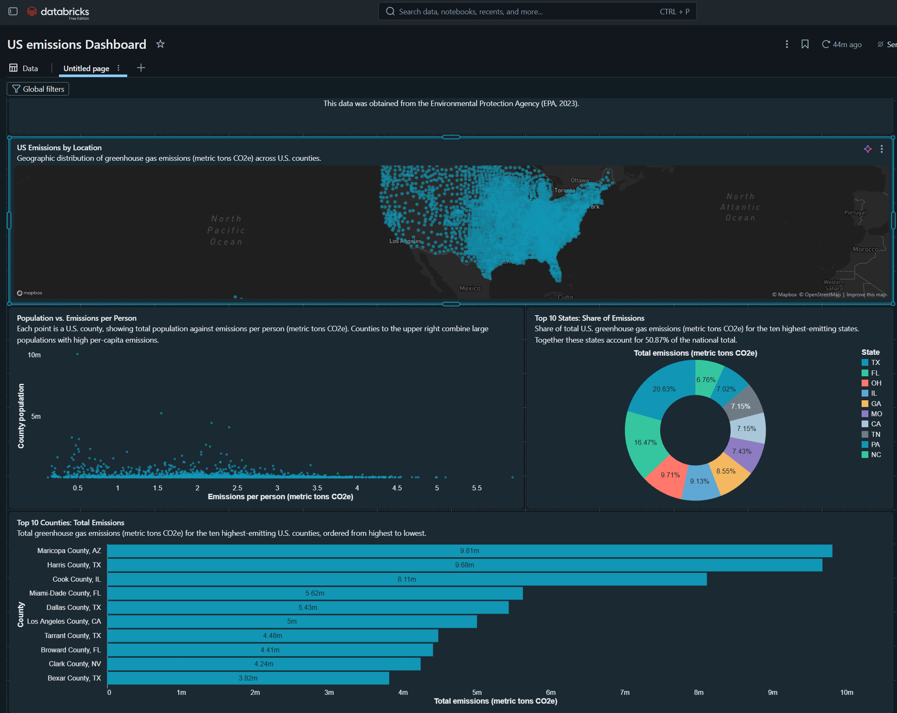

# US Emissions Dashboard

A portfolio analytics project that turns EPA greenhouse gas emissions data into an interactive, multi-view dashboard built entirely on Databricks.



## Project Overview

This project analyzes county-level greenhouse gas emissions across the United States. The data is governed in Unity Catalog, transformed with Databricks SQL, and visualized in an AI/BI Dashboard. The dashboard answers questions such as where emissions are concentrated, which counties and states pollute most, and how per-capita emissions relate to population size.

## Data Source

- Source: Environmental Protection Agency (EPA, 2023)
- Raw file: [`data/Emissions_Data_US.csv`](data/Emissions_Data_US.csv) (3,142 counties)
- Storage: Unity Catalog table `emissions.default.emissions_data_us` (Delta format)
- Grain: one row per U.S. county
- Key fields: county and state identifiers, latitude and longitude, population, employment, energy consumption (MWh, TcF, gallons), and greenhouse gas emissions in metric tons CO2e
- Columns used by the queries: `county_name`, `state_abbr`, `county_state_name`, `population`, `latitude`, `longitude`, and `GHG emissions mtons CO2e` (values with thousands separators are handled by the queries)

## Visualizations and Key Findings

### US Emissions by Location (symbol map)
County-level geographic distribution of greenhouse gas emissions. Emissions are visibly concentrated in a small number of large urban and industrial regions.

### Population vs. Emissions per Person (scatter)
Each point is a county, comparing total population against emissions per person (metric tons CO2e). Counties toward the upper right combine large populations with high per-capita emissions.

### Top 10 Counties: Total Emissions (bar chart)
The ten highest-emitting counties in the country, led by:

- Maricopa County, AZ: 9.81 million metric tons CO2e
- Harris County, TX: 9.68 million metric tons CO2e
- Cook County, IL: 8.11 million metric tons CO2e

### Top 10 States: Share of Emissions (pie chart)
The ten highest-emitting states together account for 50.87% of total national emissions, underscoring how concentrated U.S. emissions are at the state level.

## Tools Used

- Databricks SQL: data transformation, aggregation, and dataset queries
- Unity Catalog: centralized data governance and storage
- AI/BI Dashboards: interactive visualizations with maps, scatter, bar, and pie widgets

## Repository Structure

```
├── data/
│   └── Emissions_Data_US.csv                 # raw EPA 2023 county-level source data
├── dashboards/
│   └── us_emissions_dashboard.lvdash.json    # AI/BI dashboard definition
├── sql/
│   ├── emission_location_data.sql            # map widget dataset
│   ├── emissions_per_person.sql              # scatter dataset (per-capita emissions)
│   ├── emissions_by_states.sql               # top 10 states dataset
│   └── top_county_emissions.sql              # top 10 counties dataset
├── images/
│   └── dashboard_overview.png
└── README.md
```

## How to Reproduce

1. Load `data/Emissions_Data_US.csv` into a Unity Catalog table named `emissions.default.emissions_data_us`.
2. Clone this repository into a Databricks Git folder and open or import `dashboards/us_emissions_dashboard.lvdash.json`.
3. Select a SQL warehouse; each widget refreshes against the table using the queries in `sql/`.
